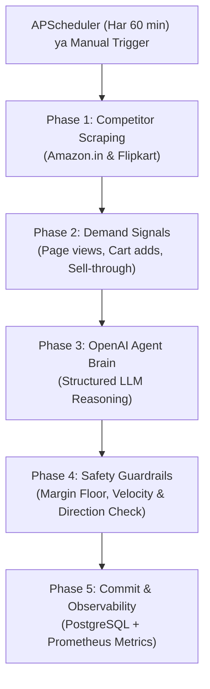

# 📖 TMLCStore — Autonomous Dynamic Pricing Agent (Complete Guide & Code Breakdown)

> **One-Line Pitch:**  
> Indian E-commerce brands (D2C) ke liye ek **Autonomous AI Dynamic Pricing Engine**, jo **Amazon.in** aur **Flipkart** ke competitor prices, inventory levels aur demand signals ko analyze karke optimal selling price (₹ INR) aur pricing strategy autonomously decide karta hai — **strict margin safety guardrails** aur **Prometheus/Grafana observability** ke sath.

---

## 📑 Table of Contents
1. [Business Problem (Yeh Project Kyun Zaroori Hai?)](#1-business-problem)
2. [High-Level Architecture](#2-high-level-architecture)
3. [Step-by-Step Codebase Reading Guide (Isko Kaise Padhein?)](#3-step-by-step-codebase-reading-guide)
4. [Agent Execution Lifecycle (5 Phases in Depth)](#4-agent-execution-lifecycle-5-phases)
5. [The 5 Autonomous Pricing Strategies](#5-the-5-autonomous-pricing-strategies)
6. [Zero-Risk Guardrails (Mathematical Safety Nets)](#6-zero-risk-guardrails)
7. [Enterprise Observability (4 Pillars)](#7-enterprise-observability-4-pillars)
8. [Backend REST API Reference (React Frontend ke liye)](#8-backend-rest-api-reference)
9. [Next Step: Streamlit se React Migration Plan](#9-next-step-streamlit-se-react-migration-plan)

---

## 1. Business Problem (Yeh Project Kyun Zaroori Hai?)

Indian E-commerce (D2C brands jaise boAt, Noise, Mamaearth, Prestige) mein pricing manually manage karna business ke liye loss-making ho sakta hai:

1. **Competitor Price Wars:**  
   Agar Flipkart par kisi rival ne ₹1,499 ka headphone ₹1,299 kar diya aur aapka price ₹1,499 hi raha, toh sales foran 80% tak drop ho sakti hai.
2. **Surge Pricing Opportunity (High Demand + Low Stock):**  
   Diwali ya festive sale ke waqt demand spike hoti hai. Agar warehouse mein sirf 40 units bache hain, toh saste mein bechna profit chhodne jaisa hai. Price 5–15% badha kar profit maximize kiya ja sakta hai.
3. **Dead Inventory (Clearance):**  
   Jo product mahino se nahi bik raha, uska price drop karke liquidity recover karna zaroori hai.
4. **LLM Hallucination Risk:**  
   Bina guardrails ke agar AI ne ₹1,500 ka item ₹150 kar diya, toh company ko lakhon ka loss hoga. Isliye TMLCStore mein **code-level hard mathematical guardrails** hain jo AI ko kabhi loss-making decision lene nahi dete.

---

## 2. High-Level Architecture

```
┌────────────────────────────────────────────────────────────────────────┐
│                        TMLCStore Dynamic Pricing Engine                │
├───────────────────┬───────────────────┬────────────────────────────────┤
│  Frontend Layer   │   Backend Layer   │       AI Agent Brain           │
│  • Streamlit (Now)│   • FastAPI REST  │       • OpenAI GPT-4o-mini     │
│  • React (Next)   │   • APScheduler   │       • Structured Reasoning   │
│    :8501 / :3000  │     :8000         │       • JSON Output            │
├───────────────────┴───────────────────┴────────────────────────────────┤
│              PostgreSQL Database (:5433 host / :5432 container)        │
│              • Products, Price Decisions, Competitor Logs, Runs        │
├────────────────────────────────────────────────────────────────────────┤
│              Observability: Prometheus (:9090) + Grafana (:3001)       │
└────────────────────────────────────────────────────────────────────────┘
```

---

## 3. Step-by-Step Codebase Reading Guide (Isko Kaise Padhein?)

Project ko deeply samajhne ke liye files ko **isi sequence mein padhein**:

### 🔹 Step 1: Database Schema Samajhein
📂 **File:** `backend/db/models.py`
- Yahan 4 main tables hain:
  1. `Product`: SKU, cost_price, current_price, min_price, max_price, inventory_count, competitor_urls.
  2. `PriceDecision`: Old price, recommended new price, applied strategy, reasoning, confidence score.
  3. `CompetitorPrice`: Competitor name (Amazon/Flipkart), scraped price, timestamp.
  4. `AgentRun`: Run status, duration, products processed, tokens used.

### 🔹 Step 2: Database Initialization & Seeding
📂 **File:** `backend/db/session.py` & `reset_products.py`
- `session.py` async SQLAlchemy engine create karta hai.
- `seed_demo_products()` function 6 realistic Indian products (boAt headphones, Noise smartwatch, Prestige mixer, etc.) ko initialize karta hai.
- `reset_products.py` tables wipe karke fresh data seed karta hai.

### 🔹 Step 3: Competitor Web Scraper
📂 **File:** `backend/scrapers/competitor.py`
- `scrape_amazon_price()` aur `scrape_flipkart_price()`: HTTPX aur BeautifulSoup se price scrape karte hain.
- **Fail-safe Simulation:** Agar Amazon/Flipkart bot detection ke kaaran block karte hain, toh `_simulate_inr_price()` function product category ke according realistic INR price generate karta hai taaki pipeline break na ho.

### 🔹 Step 4: Core AI Brain & Decision Engine (Most Important!)
📂 **File:** `backend/agents/pricing_agent.py`
- Yeh is pure project ka **Heart & Brain** hai.
- Isme 5-Phase pipeline implement hui hai (`run_agent()` aur `_process_product()` functions):
  - Competitor scraping data lena.
  - Demand signals compute karna.
  - OpenAI GPT-4o-mini ko system prompt ke sath call karna.
  - Direction consistency check aur Hard Guardrails apply karna.
  - PostgreSQL mein commit aur Prometheus metrics emit karna.

### 🔹 Step 5: Web API & Automated Scheduler
📂 **File:** `backend/main.py` aur `backend/routers/api.py`
- `main.py`: FastAPI app initialize karta hai aur **APScheduler** start karta hai jo har 60 minutes mein autonomously pricing agent run karta hai.
- `routers/api.py`: Clean REST endpoints provide karta hai:
  - `GET /api/v1/products/`
  - `GET /api/v1/decisions/`
  - `GET /api/v1/analytics/dashboard`
  - `POST /api/v1/agent/run`

### 🔹 Step 6: Observability (Prometheus & Grafana)
📂 **File:** `backend/metrics/prometheus.py` aur `monitoring/`
- Har agent run par 18+ metrics track hoti hain: token usage, latency, price change velocity, gross margin %, strategy distribution.

### 🔹 Step 7: Current Dashboard UI
📂 **File:** `frontend/app.py`
- Streamlit application jo metrics display karti hai aur manual run trigger karne ka option deti hai.

---

## 4. Agent Execution Lifecycle (5 Phases)

Har product ke liye agent in 5 steps se guzarta hai:



1. **Phase 1 (Competitor Scraping):** Amazon.in aur Flipkart se live prices fetch hote hain.
2. **Phase 2 (Demand Signals):** `demand_score` calculate hota hai (0.0 se 1.0 ke beech) based on page views aur cart-to-view ratio.
3. **Phase 3 (OpenAI LLM Reasoning):** Prompt mein product cost, current price, inventory, competitor prices pass hote hain. LLM return karta hai:
   ```json
   {
     "recommended_price": 1399,
     "strategy": "COMPETITIVE",
     "reasoning": "Amazon is selling at ₹1,449. Matching inventory levels and undercutting by 3% to capture buy-box.",
     "confidence_score": 0.88
   }
   ```
4. **Phase 4 (Guardrails Enforcement):** Python code mathematically verify karta hai ki price cost margin se kam na ho aur velocity limit mein ho.
5. **Phase 5 (Database & Metrics):** Decision save hota hai aur metrics Grafana ke liye record hoti hain.

---

## 5. The 5 Autonomous Pricing Strategies

| Strategy | Kab Apply Hoti Hai? | Price Direction | Logic |
|---|---|---|---|
| ⚡ **SURGE** | Demand score > 0.7 **AUR** Inventory ≤ low stock threshold | ▲ UP (+5% se +15%) | Demand bohot high hai, limited stock par profit maximize karo. |
| 🥊 **COMPETITIVE** | Stock normal hai, aur competitor ne price drop kiya hai | ▼ DOWN (Lowest competitor se 2–5% niche) | Customer ko rival se apni website par convert karo. |
| 📈 **DEMAND_BASED** | Normal stock, moderate demand (0.4 – 0.7) | ↕ Dynamic (±2% se ±8%) | Market appetite ke according smooth auto-adjustment. |
| 🏷️ **CLEARANCE** | Excess inventory ya sell-through rate < 0.20 | ▼ DOWN (-5% se -15%) | Dead inventory clear karke capital free karo. |
| 🛡️ **COST_PLUS** | LLM timeout, JSON error ya network failure | = Cost Price × 1.40 | Pure mathematical fallback (40% profit margin lock). |

---

## 6. Zero-Risk Guardrails (Mathematical Safety Nets)

AI agent tabhi production-ready mana jata hai jab code-level hard rules ho:

1. **Margin Floor Check:**
   $$\text{Price} \ge \text{Cost Price} \times (1 + \text{MIN\_MARGIN\_PERCENT} / 100)$$
   Default 15% margin floor hai. Agar product cost ₹1,000 hai, toh agent kisi bhi haal mein ₹1,150 se niche nahi bech sakta.
2. **Velocity Cap (Max Jump / Drop):**
   Ek single run mein price maximum **±20%** hi change ho sakta hai taaki sudden shock na aaye.
3. **Strategy-Direction Auto Correction:**
   Agar LLM ne strategy `SURGE` select ki lekin price galti se kam kar diya, toh Python code LLM ko overrule karke automatically price **+8%** badha deta hai.

---

## 7. Enterprise Observability (4 Pillars)

Project mein Prometheus (`:9090`) aur Grafana (`:3001`) setup hai jo 4 pillars track karte hain:

1. **Pillar 1 — Agent Health:** Agent run duration, scraping latency, failures.
2. **Pillar 2 — LLM Economics:** Token count, OpenAI USD cost per run, fallback frequency.
3. **Pillar 3 — Decision Quality:** Strategy breakdown pie-chart, confidence histogram.
4. **Pillar 4 — Business Impact:** Live gross margin %, estimated revenue impact.

---

## 8. Backend REST API Reference (React Frontend ke liye)

React frontend banane ke liye hum in ready-made FastAPI endpoints ka use karenge:

| HTTP Method | Endpoint | Description |
|---|---|---|
| `GET` | `/api/v1/analytics/dashboard` | KPI Stats (Total products, decisions, revenue impact, avg margin) |
| `GET` | `/api/v1/products/` | All active products with current prices and inventory |
| `GET` | `/api/v1/products/{id}` | Single product details |
| `GET` | `/api/v1/products/{id}/price-history` | Product ki historical price decisions |
| `PATCH`| `/api/v1/products/{id}` | Product price ya inventory manually update karna |
| `GET` | `/api/v1/decisions/` | Recent pricing decisions list |
| `GET` | `/api/v1/decisions/stats` | Decisions breakdown by strategy & average confidence |
| `POST`| `/api/v1/agent/run` | Manually AI Pricing Agent trigger karna (`{"triggered_by": "manual"}`) |
| `GET` | `/api/v1/agent/status` | Check karna ki agent run chal raha hai ya idle hai |
| `GET` | `/api/v1/agent/runs` | Past execution logs aur duration |

---

## 9. Next Step: Streamlit se React Migration Plan

Streamlit rapid prototyping ke liye bohot acha hai, lekin production grade D2C SaaS ke liye hum iska modern **React Dashboard** banayenge:

### React Stack Architecture:
- **Build Tool:** Vite + React (TypeScript)
- **Styling:** Tailwind CSS + Shadcn UI / Radix primitives
- **Icons:** Lucide React
- **Charts:** Recharts (Price history curves, competitor comparison bar-charts)
- **State & Data Fetching:** Axios / TanStack Query (Real-time polling & auto-refresh)

### Planned UI Screens:
1. **Overview Dashboard:** Live KPI cards (Gross Margin %, Revenue Impact, Low Stock Alerts, Active Runs).
2. **Product Catalog & Live Pricing:** Interactive table with competitor price indicators, stock badges, and manual edit modal.
3. **Decision Audit Feed:** Real-time log showing AI reasoning ("Why price changed?"), confidence score, and strategy badges (`SURGE`, `COMPETITIVE`, etc.).
4. **Agent Control Center:** One-click "Run Agent" trigger with live progress spinner, scheduler toggle, and guardrail settings.
